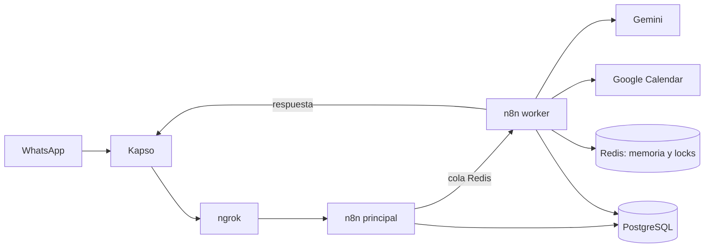

# Eli: asistente de citas por WhatsApp para EliDental

Eli atiende por WhatsApp, entiende lo que pide el cliente, consulta la agenda y reserva, mueve o
cancela citas en Google Calendar. Está construida con **n8n** (en modo queue, dentro de Docker),
**Kapso** como puente con WhatsApp y **Gemini** como modelo de IA.

| | |
|---|---|
| **En producción** | `version4` como **Eli**, asistente de [EliDental](https://www.facebook.com/EliDentalec) (Loja), con sus datos públicos de Facebook e Instagram ([workflow](workflows/eli-version4.json)) |
| **Siguiente paso** | Reglas antes que la IA y recordatorios de cita ([diseño](docs/eli-dental.md)) |
| **Stack** | n8n 2.41.5 (main + worker + runners) · PostgreSQL 18 · Redis 7 · Kapso · Gemini · Google Calendar · ngrok |



## Inicio rápido

Requisitos: Docker Desktop, git, jq, openssl y ngrok. Paso a paso completo en **[GUIA.md](GUIA.md)**.

```bash
git clone https://github.com/davidethc/agentWhatsap.git
cd agentWhatsap
scripts/init-env.sh          # crea .env con secretos nuevos
docker compose up -d         # levanta los 6 servicios
scripts/check.sh             # todo debe salir OK
```

Después: abre n8n, crea las credenciales (Kapso, Gemini, Google Calendar, Redis local) e importa
`workflows/eli-version4.json` ([GUIA, pasos 8 y 9](GUIA.md#8-credenciales-en-n8n)).

## Documentación

| Documento | Para quién | Contenido |
|---|---|---|
| [GUIA.md](GUIA.md) | Quien instala | Instalación desde cero: cuentas, Docker, ngrok, Kapso, Google, Gemini, workflow, pruebas |
| [docs/instalacion-windows.md](docs/instalacion-windows.md) | Quien instala en Windows | Instalación paso a paso en Windows 10/11 con WSL 2 y Docker Desktop, hasta que Eli responde |
| [docs/arquitectura.md](docs/arquitectura.md) | Quien desarrolla | Componentes, recorrido de un mensaje, claves de Redis, decisiones y límites |
| [docs/operacion.md](docs/operacion.md) | Quien mantiene | Encender, revisar, publicar, respaldar, restaurar, migrar y problemas conocidos |
| [docs/conversacion-natural.md](docs/conversacion-natural.md) | Producto | Qué responde Eli a cada mensaje, cómo busca horarios (libre, ocupado, lleno) y cómo cierra la cita |
| [docs/embudo-elidental.md](docs/embudo-elidental.md) | Producto y ventas | Embudo de conversación por etapas: mensajes reales, esperas, perdido y ganado, qué falta construir |
| [docs/seguridad.md](docs/seguridad.md) | Todos | Secretos y datos de pacientes |
| [docs/eli-dental.md](docs/eli-dental.md) | Producto | Conversación para dentistas, reglas, urgencias, recordatorios, costos y pendientes |
| [docs/adr/](docs/adr/) | Quien decide | Por qué el sistema es como es |
| [docs/comercial/reunion-elidental.md](docs/comercial/reunion-elidental.md) | Ventas | Guía de la reunión con EliDental: gancho, demo, preguntas, objeciones y propuesta |
| [CONTRIBUTING.md](CONTRIBUTING.md) | Quien contribuye | Normas, ramas, cómo cambiar un workflow, definición de terminado |
| [CHANGELOG.md](CHANGELOG.md) | Todos | Historial de versiones |
| [workflows/README.md](workflows/README.md) | Quien desarrolla | Catálogo de workflows |

## Comandos

| Acción | Comando |
|---|---|
| Encender | `docker compose up -d` y `ngrok http --url=TU-DOMINIO 5678` |
| Revisar salud | `scripts/check.sh` |
| Respaldo completo | `scripts/backup.sh` |
| Exportar un workflow | `scripts/export-workflow.sh <ID> workflows/<archivo>.json` |
| Apagar (conserva los datos) | `docker compose stop` |

> ⚠️ Nunca `docker compose down -v`: borra workflows, credenciales y la base de datos.

## Límites actuales

- Corre en un computador personal: si se apaga o se suspende, Eli no responde. Para 24/7 hace falta
  un servidor.
- Solo WhatsApp (Kapso). Instagram y Messenger no están integrados.
- Desde octubre de 2026, Meta cobra cada mensaje enviado ([costos](docs/eli-dental.md#8-costos)).
