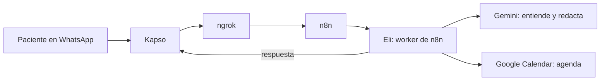

# Eli: asistente de citas por WhatsApp para EliDental

> Construcción actual: [privacidad aprobada](docs/crm/v2/privacidad.md), [plan y evidencia](docs/crm/v2/construccion.md). Incluye preparar Docker/n8n/panel/ngrok para prueba personal por WhatsApp al finalizar; todavía en verificación.

Eli contesta el WhatsApp de un consultorio dental como lo haría una recepcionista: saluda, resuelve
dudas, busca un horario libre y deja la cita anotada en Google Calendar. Lo que necesita a la doctora
(dudas de salud, quejas) se lo pasa a ella. Hoy atiende a [EliDental](https://www.facebook.com/EliDentalec)
(Loja), de la Dra. Viviana Sucunuta.

> **¿Primera vez aquí y no programas?** Empieza por [docs/como-funciona.md](docs/como-funciona.md):
> explica sin tecnicismos qué es cada pieza, qué hace Eli y cuánto cuesta.

| | |
|---|---|
| **En producción** | Workflow `version4` como **Eli**: conversación natural, sin botones, con los datos reales de EliDental (JSON fuera del repo) |
| **Eli Panel (CRM)** | Panel de la doctora (resumen, tablero de pacientes, fichas y citas) sobre Supabase, conectado a Eli con avisos sin esperar y **sin guardar el contenido de los mensajes**. Probado con datos inventados; falta conectarlo al `version4` real y Google Calendar ([guía](docs/crm/guia-doctora.md)) |
| **En producción** | Workflow `version4` como **Eli**: conversación natural, sin botones, con los datos reales de EliDental ([workflow](workflows/eli-version4.json)) |
| **Eli Panel (CRM)** | Continúa en crm-v2-diseno: conversaciones e intervención restringidas, SDD y Codex/tmux. Las pruebas del primer CRM no certifican el nuevo. [Estado y coordinación](docs/crm/README.md). |
| **Siguiente paso** | Seguimientos a quien deja de responder y recordatorios de cita ([qué falta](docs/conversacion.md)) |
| **Piezas** | WhatsApp · Kapso · n8n 2.41.5 (queue mode) · Gemini · Google Calendar · PostgreSQL · Redis · Docker · ngrok |

> **Nota:** los JSON de `workflows/` **no están en el repo** (se quedan solo en local y se comparten por
> separado). Si trabajas sin ellos, pídelos a quien mantiene el proyecto.



## Guía de la documentación

Qué leer según lo que necesites. Cada documento tiene **un solo tema**, sin repetir lo de los demás.

### Entender el proyecto

| Documento | Para qué sirve |
|---|---|
| [docs/como-funciona.md](docs/como-funciona.md) | **Empieza aquí.** Qué es Eli, para qué sirve cada pieza (Kapso, n8n, Gemini…), qué puede y qué no puede hacer, cuánto cuesta y por qué usamos Kapso. Sin tecnicismos |
| [docs/conversacion.md](docs/conversacion.md) | **Cómo habla Eli.** Qué responde a cada tipo de mensaje, cómo busca horarios (libre, ocupado, día lleno), cómo cierra la cita sin presionar, el recorrido completo del paciente por etapas, y qué ya funciona y qué falta |
| [docs/elidental.md](docs/elidental.md) | **El cliente.** Datos reales de EliDental, lo que pidió la doctora, investigación de cómo se agenda en Latinoamérica, diseño técnico de los recordatorios, costos y decisiones pendientes |

### Vender

| Documento | Para qué sirve |
|---|---|
| [docs/comercial/reunion-elidental.md](docs/comercial/reunion-elidental.md) | Guía de la reunión con la doctora: gancho, demo, preguntas que no se pueden olvidar, objeciones y propuesta de precio |

### Instalar y mantener funcionando

| Documento | Para qué sirve |
|---|---|
| [GUIA.md](GUIA.md) | Instalar todo desde cero en **Mac**: cuentas, Docker, ngrok, Kapso, Google, Gemini, credenciales e importar el workflow |
| [docs/instalacion-windows.md](docs/instalacion-windows.md) | Lo mismo, paso a paso en **Windows** 10/11 |
| [docs/operacion.md](docs/operacion.md) | El día a día: encender todo **después de reiniciar**, revisar que funcione, publicar cambios, respaldar, restaurar y problemas conocidos |
| [docs/seguridad.md](docs/seguridad.md) | Reglas para no filtrar contraseñas ni datos de pacientes |

### Eli Panel (CRM)

| Documento | Para qué sirve |
|---|---|
| [docs/crm/guia-doctora.md](docs/crm/guia-doctora.md) | **Para la doctora.** Cómo entrar, el resumen, el tablero, la ficha, nuevo paciente y citas, sin tecnicismos |
| [docs/crm/operacion.md](docs/crm/operacion.md) | **Para quien administra.** Arrancar en local, migraciones, copias de seguridad y qué hacer si el CRM cae |
| [docs/crm/eli-crm.md](docs/crm/eli-crm.md) | Cómo se entera el CRM de lo que hace Eli (y por qué no guarda los mensajes) |
| [docs/crm/](docs/crm/README.md) | Todo el proyecto: Spec, Plan, Tareas, informe de QA y decisiones |

### Para quien desarrolla

| Documento | Para qué sirve |
|---|---|
| [docs/arquitectura.md](docs/arquitectura.md) | Cómo están conectadas las piezas por dentro, recorrido técnico de un mensaje y datos guardados en Redis |
| [docs/adr/](docs/adr/) | Registro de decisiones: **por qué** el sistema es como es (modo queue, Redis local, Gemini, un solo workflow, conversación sin botones, Kapso) |
| workflows/README.md (fuera del repo) | Qué hay en cada archivo de workflow (producción, pruebas e histórico); los JSON se comparten por separado |
| [CONTRIBUTING.md](CONTRIBUTING.md) | Normas para hacer cambios sin romper producción: ramas, cómo cambiar un workflow, definición de terminado |
| [CHANGELOG.md](CHANGELOG.md) | Historial: qué cambió y cuándo |

## Inicio rápido

Requisitos: Docker Desktop, git, jq, openssl y ngrok. Paso a paso en [GUIA.md](GUIA.md) (Mac) o
[docs/instalacion-windows.md](docs/instalacion-windows.md) (Windows).

```bash
git clone https://github.com/davidethc/agentWhatsap.git
cd agentWhatsap
scripts/init-env.sh          # crea .env con contraseñas nuevas
docker compose up -d         # levanta los 6 servicios
scripts/check.sh             # todo debe salir OK
```

Después: abre n8n, crea las credenciales (Kapso, Gemini, Google Calendar, Redis local) e importa
`workflows/eli-version4.json` ([GUIA, pasos 8 y 9](GUIA.md#8-credenciales-en-n8n)). Ese JSON **no está
en el repo**: pídelo a quien mantiene el proyecto.

## Comandos

| Acción | Comando |
|---|---|
| Encender (tras reiniciar) | Ver [operacion.md](docs/operacion.md#después-de-reiniciar-el-computador) |
| Revisar que todo funcione | `scripts/check.sh` |
| Respaldo completo | `scripts/backup.sh` |
| Guardar un workflow en el repositorio | `scripts/export-workflow.sh <ID> workflows/<archivo>.json` |
| Apagar (conserva los datos) | `docker compose stop` |

> ⚠️ Nunca `docker compose down -v`: borra workflows, credenciales y la base de datos.

## Qué hay en el repositorio

```
├── README.md, GUIA.md, CONTRIBUTING.md, CHANGELOG.md
├── docker-compose.yml, .env.example   Cómo se levantan los servicios
├── scripts/                           init-env, check, backup, export-workflow
└── docs/                              Toda la documentación (ver la guía de arriba)
```

`workflows/` (los JSON de n8n) no está en el repo: se queda en local y se comparte por separado.

## Límites actuales

- Corre en un computador personal: si se apaga o se suspende, Eli no responde. Para 24/7 hace falta un
  servidor.
- El plan gratuito de Gemini se agota con pocas conversaciones al día.
- Solo WhatsApp. Instagram y Messenger no están integrados.
- Meta cobra los mensajes que Eli envía por su cuenta y las respuestas que pasan de 1.000 al mes
  ([costos](docs/elidental.md#costos)).
