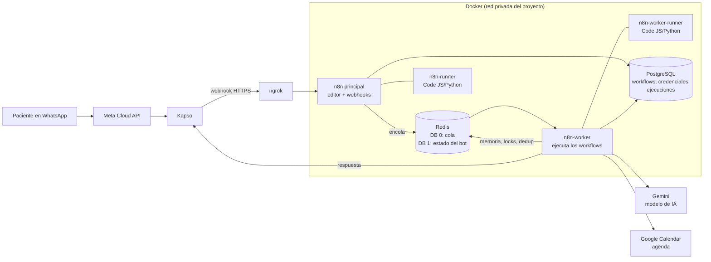
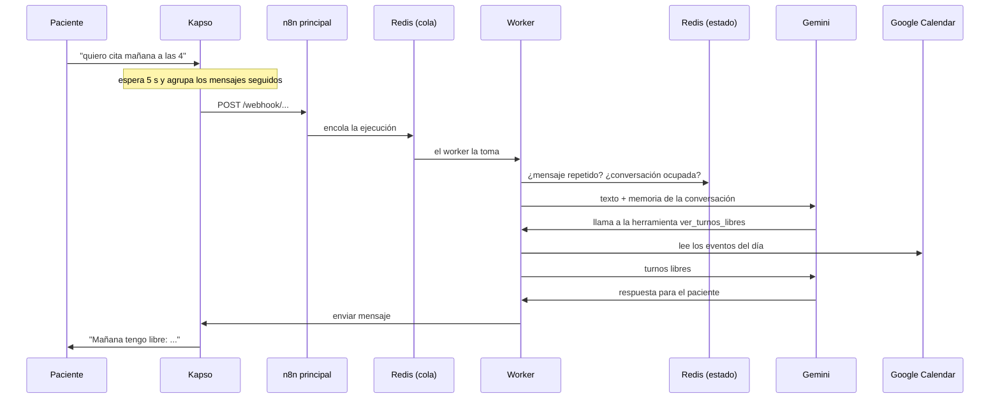

# Arquitectura

Eli es una asistente de WhatsApp que agenda citas. Corre en **n8n en modo queue** dentro de Docker. La
instancia principal recibe los mensajes y un worker los procesa. PostgreSQL guarda los datos y Redis
lleva la cola y el estado de cada conversación.

## Componentes

| Servicio | Imagen | Función | Expuesto |
|---|---|---|---|
| `n8n` | `n8nio/n8n:2.41.5` | Editor, webhooks, encola ejecuciones, broker de tareas | `127.0.0.1:5678` |
| `n8n-worker` | `n8nio/n8n:2.41.5` | Ejecuta los workflows de producción tomados de la cola | No |
| `n8n-runner` | `n8nio/runners:2.41.5` | Ejecuta nodos Code del principal (pruebas manuales) | No |
| `n8n-worker-runner` | `n8nio/runners:2.41.5` | Ejecuta nodos Code del worker | No |
| `postgres` | `postgres:18` | Base de datos de n8n | No |
| `redis` | `redis:7-alpine` | Cola de n8n (DB 0) y estado del bot (DB 1) | No |
| ngrok | (en el host) | Túnel HTTPS público hacia `127.0.0.1:5678` | Internet |

Volúmenes persistentes:
- `agentwhatsap_n8n_data`: datos del principal. También guarda la SQLite antigua, que ya no se usa.
- `agentwhatsap_n8n_worker_data`: datos del worker, por ejemplo su copia del nodo Kapso.
- `agentwhatsap_postgres_data` y `agentwhatsap_redis_data`: datos de PostgreSQL y de Redis (con AOF activado).

## Recorrido de un mensaje

## El workflow de producción: `version4`

Todo vive en un solo workflow ([`workflows/eli-version4.json`](../workflows/eli-version4.json)). Tiene dos entradas:

1. **Webhook Kapso.** Recibe los mensajes del paciente: normaliza el texto, descarta repetidos, toma un
   lock de la conversación, consulta al agente, responde y, al final, procesa los mensajes que llegaron
   mientras respondía.
2. **Agenda (entrada interna).** El agente la usa como herramienta (`ver_turnos_libres`,
   `reservar_cita`). Valida el pedido, lee Google Calendar, calcula turnos de 1 hora y crea el evento.
   Antes de reservar vuelve a comprobar que el turno siga libre.

El agente también tiene `buscar_mis_citas`, `mover_cita` y `cancelar_cita`, que son herramientas
directas de Google Calendar.

Los datos del consultorio (horario 09:00–18:00 provisional, domingo cerrado y servicios; sin
precios) se editan en el nodo **Validar pedido**. La personalidad y las reglas de Eli están en el *system message* del nodo **Agente version4**.

## Claves de Redis (DB 1)

| Clave | Tipo | Duración | Uso |
|---|---|---|---|
| `v4:dedup:<message_id>` | contador | 24 h | Ignorar el mismo mensaje entregado dos veces |
| `v4:lock:<teléfono>` | contador | 120 s | Una sola respuesta a la vez por conversación |
| `v4:pending:<teléfono>` | lista | hasta procesarse | Mensajes que llegaron mientras Eli respondía |
| `v4:chat:<teléfono>` | memoria | 24 h, últimos 12 mensajes | Historial que lee la IA |

La DB 0 es de n8n (claves `bull:*`): no se toca a mano.

## Decisiones de arquitectura

Cada decisión importante tiene su registro (ADR) en [`docs/adr/`](adr/):

| ADR | Decisión | Estado |
|---|---|---|
| [0001](adr/0001-queue-mode.md) | n8n en modo queue con PostgreSQL, Redis, worker y runners | Aceptada |
| [0002](adr/0002-redis-local.md) | Redis local (DB 1) para el estado del bot, en vez de Redis Cloud | Aceptada |
| [0003](adr/0003-gemini.md) | Gemini como único modelo de IA | Aceptada |
| [0004](adr/0004-un-solo-workflow.md) | Un solo workflow con la agenda como entrada interna | Aceptada |
| [0005](adr/0005-reglas-antes-que-ia.md) | Reglas fijas y botones antes que la IA (diseño para dentistas) | Propuesta |

## Límites conocidos

- **Corre en un computador personal.** Si el Mac se suspende, el bot deja de responder y, al
  despertar, n8n se reconecta solo. Para atender 24/7 hace falta un servidor siempre encendido.
- **ngrok gratuito** usa un dominio fijo, pero el túnel muere si se cierra la terminal.
- **Dos reservas simultáneas del mismo turno** pueden crear dos eventos: `version4` revisa el turno
  justo antes de crear el evento, pero no lo bloquea. Ver [eli-dental.md](eli-dental.md).
- **Costo de Meta:** desde el 1 de octubre de 2026, Meta cobra cada mensaje enviado, también dentro de
  la ventana de 24 horas. Ver [eli-dental.md](eli-dental.md#8-costos).
