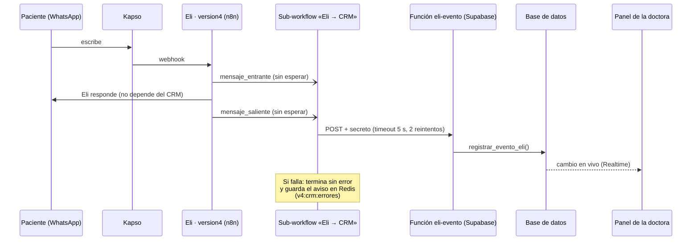

# Cómo funciona Eli → CRM

Cómo se enteran el panel y la base de datos de lo que pasa en WhatsApp. Contrato completo y
decisiones: [plan.md §5](plan.md), [ADR 0008](../adr/0008-crm-supabase-eventos.md) y
[ADR 0012](../adr/0012-crm-sin-contenido-de-mensajes.md).

## La idea en una frase

Eli (el workflow `version4` de n8n) **avisa** al CRM de tres cosas —llegó un mensaje, Eli respondió y se
reservó una cita— **sin esperar respuesta**. Si el CRM no está, Eli responde igual y el aviso se guarda para
revisarlo. **El CRM nunca recibe lo que escribió el paciente: solo que escribió y cuándo.**

## Recorrido de un mensaje

Las flechas con círculo (`-)`) son llamadas **sin esperar**: Eli no se detiene por ellas.

## Los tres avisos

`telefono` se acepta como `09…`, `+593…` o `593…` y se guarda siempre como `593…`.

| Evento | Qué lleva | Qué hace en el CRM |
|---|---|---|
| `mensaje_entrante` | `telefono`, `nombre_whatsapp`, `message_id`, `en` | Si es un número nuevo, crea la conversación y al paciente en **Nuevo**. Cuenta un mensaje del paciente. Con el **2.º mensaje**, Nuevo → **Conversando**. Si estaba en **Perdido** y vuelve a escribir, regresa a **Conversando**. |
| `mensaje_saliente` | `telefono`, `execution_id`, `en` | Registra que Eli respondió. No cuenta como mensaje del paciente. |
| `cita_reservada` | `telefono`, `gcal_event_id`, `inicio`, `fin`, `servicio`, `nombre` | Crea la cita (origen *eli*) ligada al titular del teléfono y lo pasa a **Agendó**. |

Todo lo que cambia queda con **actor = eli** en el historial de etapas y en la auditoría.

### Privacidad: sin texto de mensajes

Ningún aviso lleva el contenido del mensaje (decisión del 11-oct-2026, TK-41):

- los nodos «CRM: armar …» de `version4` no lo incluyen;
- el sub-workflow `Eli → CRM` descarta `texto` si llegara;
- `eli-evento` y la base **rechazan** un aviso que lo traiga (error 400 «texto ya no se acepta»);
- la tabla `mensajes` ya no tiene la columna `texto`: solo `dirección`, `fecha` y un identificador.

Para volver a guardarlo hay que seguir «Cómo volver atrás» del ADR 0012.

## Reglas que se cumplen siempre

- **Sin duplicados.** Cada aviso lleva un identificador (`message_id`, `execution_id` o `gcal_event_id`).
  Si el mismo llega dos veces (un reintento, por ejemplo), la segunda vez responde `duplicado: true` y no
  cambia nada.
- **Un teléfono, varios pacientes.** Los avisos siempre se aplican al **titular** (el paciente dueño del
  número); sus dependientes comparten la conversación.
- **24 horas sin respuesta.** Una tarea de la base (cada 15 minutos) pasa a **Perdido (no respondió)** a quien
  esté en Nuevo o Conversando, sin cita futura y con más de 24 h sin escribir.
- **Las reglas viven en la base**, no en n8n ni en el panel ([ADR 0011](../adr/0011-reglas-embudo-en-la-base.md)),
  así todos los caminos las aplican igual.

## Qué respuestas da `eli-evento`

| HTTP | Significa |
|---|---|
| 200 `{"ok":true,"duplicado":false}` | Guardado. |
| 200 `{"ok":true,"duplicado":true}` | Ya estaba (reintento): no se duplicó. |
| 400 | JSON inválido, falta un campo, teléfono o fecha no válidos, o llegó `texto`. |
| 401 | Falta el secreto o es incorrecto. |
| 500 | Fallo interno: queda una fila en la tabla de errores de integración, sin teléfono ni texto. |

El secreto (`ELI_EVENTO_SECRETO`) vive solo en las credenciales de n8n («Eli CRM secreto») y en los secretos
de Supabase; nunca en git.

## Si el CRM no responde

1. n8n lo intenta **3 veces** (la primera más 2 reintentos) con un tiempo máximo de 5 s cada una.
2. Si sigue sin responder, el sub-workflow **termina sin error** y guarda el aviso en la lista de Redis
   `v4:crm:errores` (máximo 200; los más viejos se descartan). La entrada tiene la hora, el error y el aviso
   (tipo, teléfono, nombre de WhatsApp, identificadores y fecha; **sin texto**).
3. Eli ya respondió: la doctora no nota nada, salvo que el paciente tarda en aparecer en el panel.
4. Cómo revisarlo y qué hacer: [operacion.md](operacion.md#si-el-crm-cae).

## Dónde está cada pieza

| Pieza | Archivo |
|---|---|
| Sub-workflow `Eli → CRM` | [`workflows/eli-crm.json`](../../workflows/eli-crm.json) |
| Los 3 armadores dentro de `version4` | se generan con [`scripts/crm-copia-version4.jq`](../../scripts/crm-copia-version4.jq); copia de prueba (inactiva): [`workflows/pruebas/eli-version4-crm-copia.json`](../../workflows/pruebas/eli-version4-crm-copia.json) |
| Función de entrada | [`supabase/functions/eli-evento/`](../../supabase/functions/eli-evento/README.md) |
| Reglas del embudo | `registrar_evento_eli` y `perdidos_por_silencio` en [`supabase/migrations/`](../../supabase/migrations) |
| Cómo se conectará al `version4` real | [integracion-version4.md](integracion-version4.md) (TK-20, pendiente de tu aprobación) |
| Cómo se probó | [qa.md](qa.md), rondas 1, 3 y 5 (TK-7, TK-8, TK-37) |

> **Estado:** el `version4` **real** todavía no está conectado al CRM (TK-20 espera aprobación y respaldo). La
> integración está probada de punta a punta con la copia inactiva y datos inventados.

## Pendiente: Google Calendar

La sincronización de citas con Google Calendar (subir las citas del panel, leer los cambios de la agenda y
resolver conflictos) es la **última parte** y todavía no está hecha ni probada. No cambia nada de lo de arriba:
Eli → CRM funciona sin ella. Guía de preparación: [google-calendar.md](google-calendar.md) y
[ADR 0009](../adr/0009-sync-google-calendar.md).
