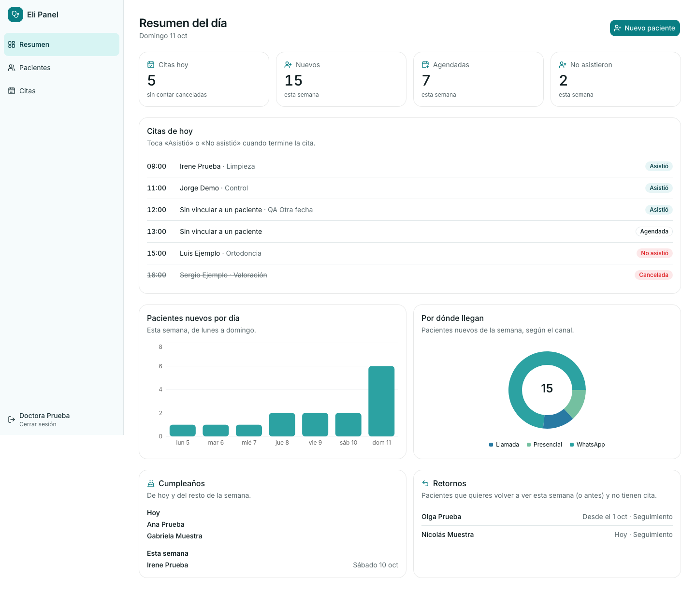
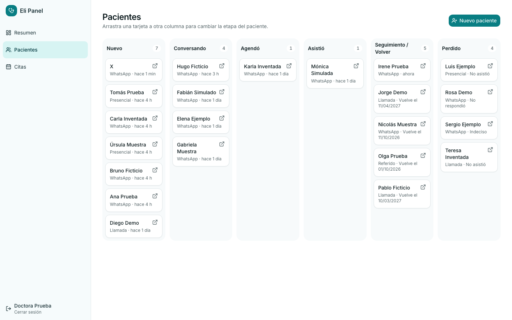
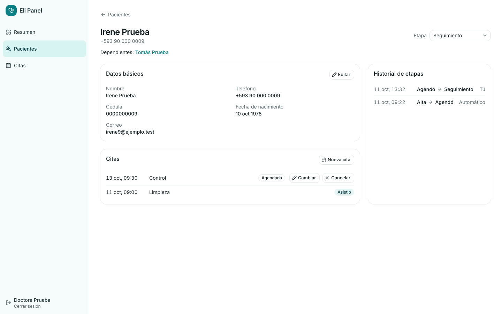
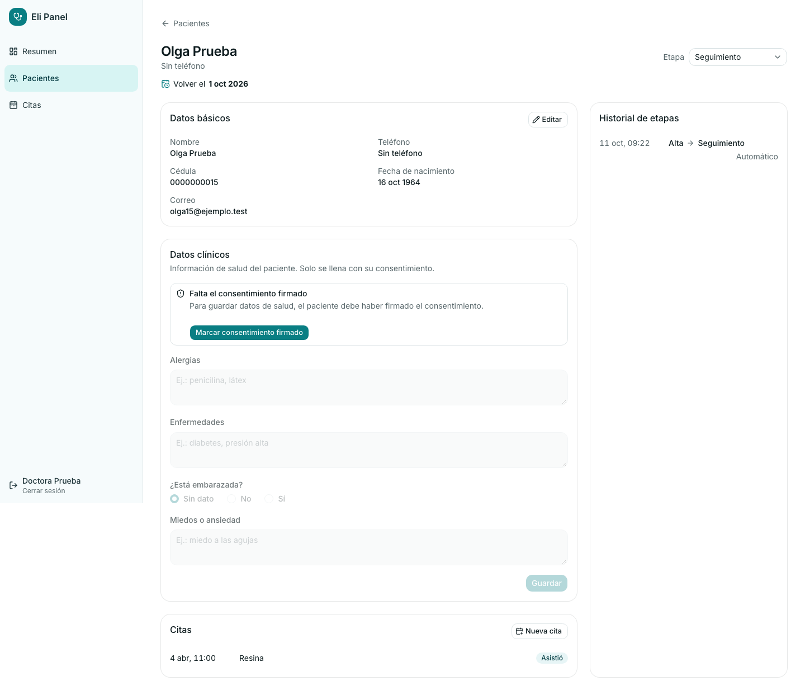
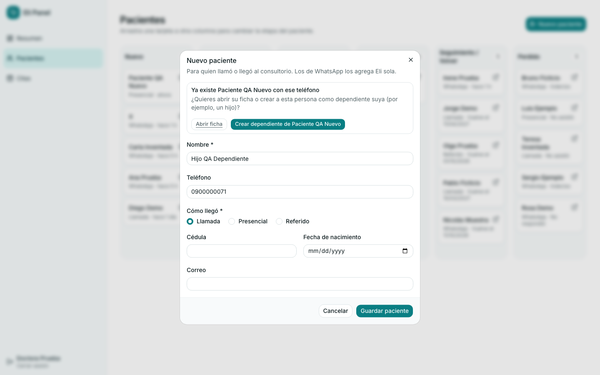
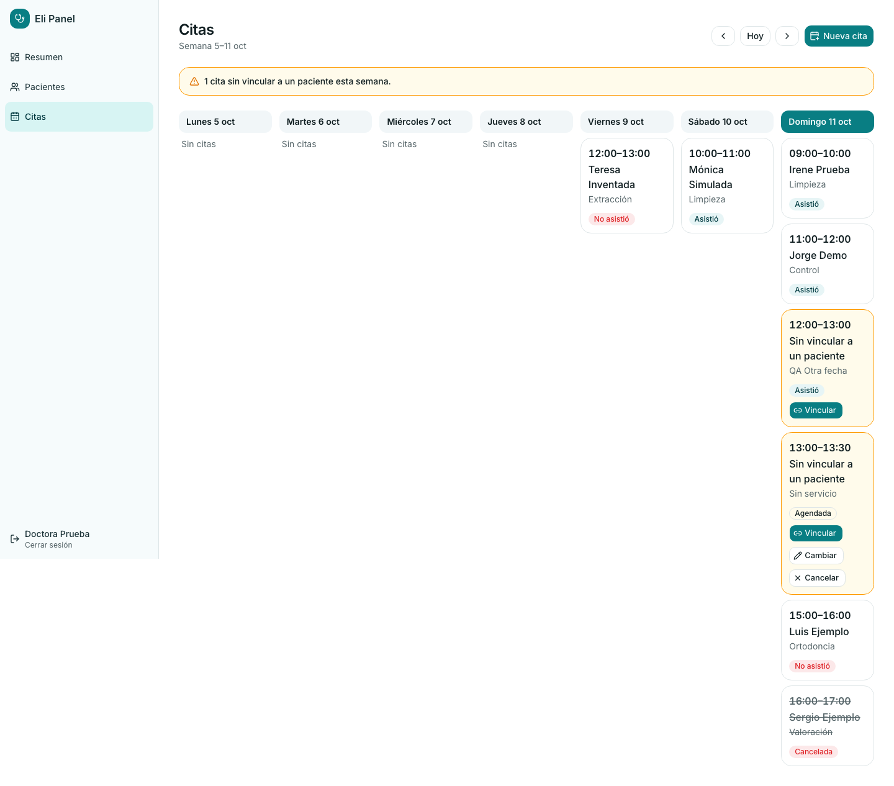

# Guía del Eli Panel para la doctora

Esta guía es corta y sin tecnicismos. Todo lo que ves en las fotos son **datos inventados**.

**Eli Panel** es tu agenda y tu lista de pacientes en una sola pantalla. Cuando alguien escribe a Eli
por WhatsApp, aparece solo en el panel. Tú lo ves, lo atiendes y lo vas pasando de etapa.

> Importante: el panel **no guarda lo que los pacientes le escriben a Eli**, por privacidad. Solo sabe
> que la persona escribió y cuándo. Si necesitas leer la conversación, está en WhatsApp.

## 1. Entrar y salir

1. Abre el panel en tu computadora (el enlace te lo da quien administra Eli).
2. Escribe tu **correo** y tu **clave** y pulsa **Entrar**.
3. Si te equivocas, el panel te lo dice: «Correo o clave incorrectos».
4. Para salir, abajo a la izquierda pulsa donde dice tu nombre y **Cerrar sesión**.

No hay «Registrarme»: las cuentas las crea quien administra Eli. Si olvidaste tu clave, pídesela a esa
persona. **No compartas tu clave**: el panel tiene datos de salud.

A la izquierda siempre tienes tres secciones: **Resumen**, **Pacientes** y **Citas**.

## 2. Resumen: tu día de un vistazo

Al entrar ves:

- **Cuatro números:** citas de hoy, pacientes nuevos de la semana, citas agendadas de la semana y
  personas que no asistieron.
- **Citas de hoy**, ordenadas por hora, con el paciente y el tratamiento.
- **Pacientes nuevos por día** y **por dónde llegan** (WhatsApp, llamada, presencial o referido).
- **Cumpleaños** de hoy y de la semana.
- **Retornos**: pacientes a quienes ya les toca volver y todavía no tienen cita.

Los cumpleaños y los retornos son solo para que tú sepas: **el panel no envía mensajes**. Si tocas un
nombre, se abre su ficha.

### Cuando termina una cita

Cada cita de hoy tiene dos botones:

- **Asistió:** el panel te pregunta **cuándo quieres volver a ver** al paciente: en 3 meses, **6 meses
  (lo recomendado)**, 1 año, otra fecha, o sin fecha. Después de guardar, el paciente pasa a
  **Seguimiento**.
- **No asistió:** el panel te pide confirmar. El paciente pasa a **Perdido**, con el motivo «No asistió».

Así sabes siempre quién vino y quién faltó.

## 3. Pacientes: el tablero por etapas

Cada paciente es una tarjeta. Las columnas son las etapas por las que pasa:

| Etapa | Qué significa |
|---|---|
| **Nuevo** | Acaba de escribir (o lo registraste tú) y todavía no ha conversado. |
| **Conversando** | Ya respondió a Eli. |
| **Agendó** | Tiene una cita. |
| **Asistió** | Vino a su cita. |
| **Seguimiento / Volver** | Ya fue atendido y le toca volver más adelante (se ve la fecha). |
| **Perdido** | No siguió. Siempre se anota el motivo: no respondió, indeciso o no asistió. |

**Eli mueve a los pacientes sola** cuando escriben, cuando agendan una cita y cuando pasan 24 horas sin
respuesta. Tú también puedes moverlos:

- **Arrastra** la tarjeta a otra columna. Si la sueltas en **Perdido**, el panel te pregunta el motivo.
- Con el teclado: selecciona la tarjeta, **Espacio**, flechas ← →, **Espacio** para soltar.
- Cada cambio queda guardado con **quién lo hizo y cuándo**.

**Buscar:** escribe un nombre o un teléfono arriba. Funciona con «099…» o con «+593…».

Si ves el punto verde **«En vivo»**, los cambios (por ejemplo, alguien que acaba de escribir a Eli)
aparecen **solos**, sin recargar la página.

## 4. La ficha del paciente

En cada tarjeta hay un pequeño ícono de «abrir» (esquina superior derecha): púlsalo para abrir la ficha del paciente.

Ahí encuentras:

- **Datos básicos:** nombre, teléfono, cédula, fecha de nacimiento y correo. Pulsa **Editar** para
  cambiarlos. Cada cambio queda registrado (quién y cuándo).
- **Etapa:** la puedes cambiar desde la ficha.
- **Citas** del paciente y el botón **Nueva cita**.
- **Historial de etapas:** todo el recorrido, con fecha, quién lo movió y el motivo si se perdió.
- **Responsable y dependientes:** si un niño comparte el teléfono de su mamá, cada uno tiene su ficha y
  se enlazan entre sí.

### Datos clínicos y consentimiento

Alergias, enfermedades, embarazo y miedos **solo se pueden llenar si el paciente firmó el
consentimiento** (en papel, en el consultorio). Mientras no esté firmado, esos campos están bloqueados y
la ficha te lo avisa.

1. Pulsa **Marcar consentimiento firmado**.
2. Elige el **día** en que firmó.
3. Ahora sí puedes llenar los datos clínicos y pulsar **Guardar**.

## 5. Nuevo paciente

Para quien llama por teléfono o llega al consultorio (los de WhatsApp los agrega Eli sola).

1. En **Resumen** o **Pacientes**, pulsa **Nuevo paciente**.
2. Llena el **nombre**, el **teléfono** (si lo tiene) y **cómo llegó**: llamada, presencial o referido. La
   cédula, la fecha de nacimiento y el correo son opcionales.
3. Pulsa **Guardar paciente**. Aparece en la columna **Nuevo**.

**Si el teléfono ya existe**, el panel te avisa («Ya existe…») y te ofrece dos caminos:

- **Abrir ficha:** para no duplicar a la misma persona.
- **Crear dependiente:** para un hijo u otro familiar que comparte ese teléfono. Queda enlazado a su
  responsable.

## 6. Citas

La pantalla **Citas** muestra la **semana** de lunes a domingo. Con las flechas pasas a la semana
anterior o siguiente, y **Hoy** te devuelve a la actual.

- **Nueva cita:** elige el paciente, el día, la hora, cuánto dura (por defecto **1 hora**) y el servicio.
  Al crearla, el paciente pasa a **Agendó**.
- **Cambiar:** mueve la hora o la duración de una cita agendada.
- **Cancelar:** el panel te pide confirmar y la cita queda como «Cancelada».
- **Vincular:** si hay una cita **sin paciente** (aparece resaltada con un aviso arriba), pulsa
  **Vincular** y elige a quién pertenece.

El panel **no te deja** agendar:

- **Fuera del horario** del consultorio: lunes a viernes de 09:00 a 18:00 y sábado de 09:00 a 15:00. Te
  avisa «La cita está fuera del horario del consultorio».
- **Encima de otra cita:** te avisa «Ya hay otra cita en ese horario».

> **Pendiente: Google Calendar.** Todavía no está conectado: por ahora las citas viven solo en el panel.
> Cuando se conecte, las citas se verán también en tu Google Calendar y las que pongas allá aparecerán
> aquí. Esta guía se actualizará entonces.

## 7. Si algo no se ve bien

| Qué pasa | Qué hacer |
|---|---|
| No puedes entrar | Revisa el correo y la clave; si sigue, pide ayuda a quien administra Eli. |
| El punto dice «Sin conexión en vivo» | Recarga la página (tecla **F5**). Tus datos están a salvo. |
| Un paciente nuevo no aparece | Espera unos segundos o recarga. Eli sigue atendiendo aunque el panel falle: el paciente aparecerá cuando el panel se recupere. |
| Un mensaje en rojo al guardar | Léelo: suele decir qué falta (por ejemplo, el horario). Corrige y vuelve a guardar. |

Si el panel se cae, **Eli sigue respondiendo a tus pacientes**. Avisa a quien administra Eli.

## Privacidad en una línea

Los datos de tus pacientes solo los ven las personas con cuenta en el panel. Cierra tu sesión si dejas la
computadora, y nunca compartas tu clave.
