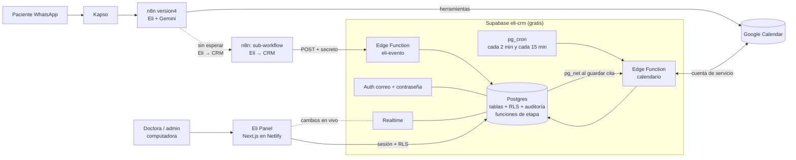

> **Vigencia 2026-10-16:** historial del CRM legado. Para el CRM nuevo rige [transicion-v2.md](transicion-v2.md) y ADR 0013. Las aprobaciones anteriores no se trasladan automáticamente.

# Eli Panel: Plan técnico (aprobado)

> Espejo de Notion «04 · Plan técnico» del hub
> [Eli Panel — SDD Hub](https://app.notion.com/p/3f55445f5f868115ab4acac0869bd112).
> **Aprobado el 10-oct-2026** (punto de control 2, junto con las Tareas: [tasks.md](tasks.md)).
> Basado en la [Spec](spec.md) y en las rondas 1–4 de «03 · Clarificaciones». Notion manda.

## 1. Resumen

- **Base de datos, login, tiempo real y funciones:** Supabase gratis, proyecto nuevo `eli-crm`.
- **Panel:** Next.js (App Router, TypeScript) + shadcn/ui + Tailwind + dnd-kit + Lucide, publicado en
  **Netlify gratis**.
- **Eli → CRM:** n8n llama, **sin esperar**, a una función de Supabase (`eli-evento`) con 3 eventos.
  Si el CRM falla, Eli sigue.
- **Google Calendar:** lo sincroniza una función de Supabase (`calendario`) con una **cuenta de
  servicio**: el panel escribe en Calendar en segundos, y lo que cambie en Calendar llega al panel
  cada 2 min.
- **Reglas del embudo en un solo lugar:** funciones de la base de datos. Eli, el panel, la
  sincronización y la tarea de las 24 h usan las mismas.

Frontend (ronda 3): formularios con react-hook-form + zod, fechas con date-fns en español (zona
`America/Guayaquil`), gráficos de shadcn (Recharts), Table de shadcn (+ TanStack Table si hace falta),
estilo clínico limpio (blanco, menú lateral, acento turquesa suave, Inter), paleta en un solo archivo.

## 2. Arquitectura



**Por qué así:** la base del CRM está separada del Postgres de n8n. Eli solo envía eventos y nunca
espera respuesta. Google Calendar lo maneja un solo módulo que funciona aunque la Mac esté apagada.
Ver los ADR [0008](../adr/0008-crm-supabase-eventos.md), [0009](../adr/0009-sync-google-calendar.md),
[0010](../adr/0010-netlify.md) y [0011](../adr/0011-reglas-embudo-en-la-base.md).

## 3. Glosario

| Término | Qué es | Evitar |
|---|---|---|
| **Paciente** | Una persona con su ficha y su etapa en el embudo. | cliente, lead, contacto |
| **Conversación** | El chat de un número de WhatsApp con Eli. Varios pacientes pueden compartirla. | chat, hilo |
| **Titular** | El paciente dueño del número de la conversación (quien escribe). | dueño, principal |
| **Responsable** | El paciente a cargo de otro (p. ej. la mamá de un niño). El dependiente comparte su conversación. | tutor, padre |
| **Etapa** | Nuevo, Conversando, Agendó, Asistió, Seguimiento, Perdido. | estado, fase |
| **Cita** | Un turno en la agenda, ligado a un evento de Google Calendar. | turno, reserva, evento |
| **Retorno** | La fecha en que la doctora quiere volver a ver al paciente («volver el»). | recall, control |
| **Consentimiento** | La firma en papel que autoriza guardar datos clínicos; se registra con su fecha. | permiso |
| **Personal** | Quien puede entrar al panel: la doctora o el administrador. | usuario, staff |

## 4. Modelo de datos (Supabase / Postgres)

Reglas: nombres en español y en minúsculas; claves `bigint generated always as identity`;
`timestamptz`; claves foráneas **con índice**; `created_at`/`updated_at`; **RLS activado en todas las
tablas**; funciones `security definer` en el esquema `private` con `search_path = ''`; en las
políticas, `(select auth.uid())`.

**Tipos (enum):** `etapa` (nuevo, conversando, agendo, asistio, seguimiento, perdido) ·
`motivo_perdido` (no_respondio, indeciso, no_asistio) · `estado_cita` (agendada, asistio, no_asistio,
cancelada) · `origen_paciente` (whatsapp, llamada, presencial, referido) · `origen_cita` (eli, panel,
calendario) · `rol_personal` (doctora, admin) · `actor` (personal, eli, sistema, calendario).

| Tabla | Columnas clave | Índices / restricciones |
|---|---|---|
| `personal` | `user_id uuid` (pk → auth.users), `nombre`, `rol` | La llena el admin. No hay registro público |
| `conversaciones` | `id`, `telefono text` (593…), `nombre_whatsapp`, `turnos_entrantes int`, `ultimo_entrante_en` | `unique(telefono)`, `check (telefono ~ '^593[0-9]{8,9}$')` |
| `pacientes` | `id`, `conversacion_id` (null si no tiene teléfono), `responsable_id` (→ pacientes), `nombre`, `cedula`, `fecha_nacimiento`, `correo`, `origen`, `etapa`, `motivo_perdido`, `volver_el date`, `consentimiento_firmado_en`, `etapa_cambiada_en` | Índices en `conversacion_id`, `responsable_id`, `etapa`, `volver_el`; **un solo titular por conversación** (único parcial `where responsable_id is null`); `check` motivo solo si etapa = perdido; búsqueda `pg_trgm` en `nombre` |
| `datos_clinicos` | `paciente_id` (pk), `alergias`, `enfermedades`, `embarazo bool`, `miedo text` | Trigger: **no se guarda si el paciente no tiene consentimiento** |
| `mensajes` | `id`, `conversacion_id`, `id_externo text`, `direccion` (entrante/saliente), `enviado_en` (**sin `texto`**: el CRM no guarda el contenido, [ADR 0012](../adr/0012-crm-sin-contenido-de-mensajes.md)) | `unique(id_externo)`; índice `(conversacion_id, enviado_en)` |
| `citas` | `id`, `paciente_id` (null = sin vincular), `gcal_event_id`, `gcal_etag`, `inicia_en`, `termina_en`, `servicio`, `estado`, `origen`, `sync` (ok/pendiente/error), `sync_error` | `unique(gcal_event_id)`; índices `(inicia_en)`, `paciente_id`; parcial `where sync <> 'ok'`; `check termina_en > inicia_en` |
| `cambios_etapa` | `id`, `paciente_id`, `de`, `a`, `motivo_perdido`, `actor`, `personal_id`, `en` | Índice `(paciente_id, en)` |
| `horario` | `dia_semana`, `abre`, `cierra` | Semilla: L–V 09–18, sábado 09–15 (igual que Eli) |
| `auditoria` | `id`, `tabla`, `fila_id`, `accion`, `antes jsonb`, `despues jsonb`, `actor`, `personal_id`, `en` | Solo inserta el trigger; nadie la edita ni la borra |
| `sync_calendario` | `calendario_id`, `sync_token`, `ultima_sync_en` | Solo la usa la función `calendario` |
| `errores_integracion` | `id`, `origen` (eli/calendario), `detalle jsonb`, `en` | Para revisar fallos (HU-13) |

**RLS:** cada tabla tiene políticas `select/insert/update` solo `to authenticated using ((select
private.es_personal()))`, que comprueba que `auth.uid()` esté en `personal`. Sin políticas para
`anon`. `auditoria`, `sync_calendario` y `errores_integracion` son de solo lectura para el personal.

**Auditoría:** un trigger `private.auditar()` en `pacientes`, `datos_clinicos` y `citas` guarda el
antes y el después. El actor sale de `auth.uid()` o, para Eli, la sincronización y la tarea programada,
de `set_config('app.actor', …)`.

**Funciones (la interfaz de escritura, deep module):** el panel y las integraciones no actualizan las
tablas a mano; llaman a estas funciones, que aplican las reglas y dejan historial.

| Función | Qué hace | HU |
|---|---|---|
| `mover_etapa(paciente, etapa, motivo)` | Cambio manual; pide motivo si es Perdido; registra `cambios_etapa` | 5 |
| `marcar_asistencia(cita, asistio, volver_en)` | Asistió → cita asistio + paciente Seguimiento + `volver_el` (6 meses por defecto, se puede vaciar). No asistió → Perdido (no_asistio) | 2 |
| `crear_paciente(datos, responsable)` | Normaliza el teléfono; si ya existe, devuelve «duplicado» con la ficha, salvo que venga un responsable (dependiente) | 8 |
| `guardar_cita(...)` / `cancelar_cita(cita)` | Valida horario y choque con citas no canceladas, 1 h por defecto, marca `sync = pendiente`; al crear → Agendó | 9 |
| `registrar_evento_eli(jsonb)` | Contrato con Eli (sección 5), idempotente | 11, 12 |
| `resumen_del_dia(fecha)` | Citas de hoy, números de la semana por canal, cumpleaños y retornos | 2, 3, 4 |

**Tareas programadas (pg_cron):** cada 15 min, `private.perdidos_por_silencio()`: Nuevo/Conversando
sin cita futura y con `ultimo_entrante_en` de hace más de 24 h → Perdido (no_respondio), actor
sistema. Cada 2 min llama a la función `calendario`.

**Tiempo real:** publicación de Realtime en `pacientes`, `citas` y `mensajes`.

## 5. Contrato Eli → CRM

**Ruta:** `POST https://<proyecto>.supabase.co/functions/v1/eli-evento` con el encabezado
`x-eli-secreto` (variable `ELI_EVENTO_SECRETO`, en las credenciales de n8n y en los secretos de
Supabase). La función valida el JSON y llama a `registrar_evento_eli`. Responde `200 {ok, duplicado}`.

| Evento | Datos | Efecto | Idempotencia |
|---|---|---|---|
| `mensaje_entrante` | `telefono`, `nombre_whatsapp`, `message_id`, `en` (**sin `texto`**) | Crea la conversación y el titular en **Nuevo** si es la primera vez; registra que hubo mensaje (sin su contenido); suma un turno; con 2 turnos o más, Nuevo → **Conversando**; Perdido → **Conversando** (reactivación) | `id_externo = message_id` (el mismo del dedup de n8n) |
| `mensaje_saliente` | `telefono`, `execution_id`, `en` (**sin `texto`**) | Registra que Eli respondió (sin su contenido) | `id_externo = 'out:' + execution_id` |
| `cita_reservada` | `telefono`, `gcal_event_id`, `inicio`, `fin`, `servicio`, `nombre` | Crea o actualiza la cita (origen eli) ligada al titular; paciente → **Agendó**. `nombre` reemplaza el nombre automático (WhatsApp o «Sin nombre»), nunca uno editado en el panel | `unique(gcal_event_id)` |
| `cita_movida` | `telefono`, `gcal_event_id`, `inicio`, `fin` (opcional: si falta, conserva la duración) | Cambia la hora de la cita con ese `gcal_event_id` (`sync = ok`). Si el CRM no la conoce, la crea como `cita_reservada`. Una cita ya atendida, no asistida o cancelada no se mueve | Misma hora → `duplicado: true` |
| `cita_cancelada` | `telefono`, `gcal_event_id` | La cita pasa a **cancelada** (`sync = ok`; no cambia la etapa, igual que en el panel). Si el CRM no la conoce, no hace nada y responde ok | Ya cancelada → `duplicado: true` |

**En n8n:** un workflow nuevo, `Eli → CRM` (`workflows/eli-crm.json`): entrada interna → HTTP Request
(timeout 5 s, 2 reintentos) → si falla, guarda el error en `v4:crm:errores` (Redis, lista recortada a
200) y termina sin error. `version4` lo llama con **Execute Workflow sin esperar** en 3 puntos: después
de «¿Mensaje nuevo?» (sí), después de «Responder por WhatsApp» y después de «Crear evento». Eli **no
espera** y no depende del resultado.

**Mover y cancelar de Eli (12-oct-2026, pedido del usuario: CRM sincronizado con Eli):** `mover_cita`
y `cancelar_cita` escriben en Google Calendar y además mandan `cita_movida` o `cita_cancelada`, así el
panel se entera al instante. La sincronización con Calendar (≤ 2 min) queda como red de seguridad.
Los cambios quedan en la auditoría con actor `eli`.

**Si el CRM falla, Eli sigue:** la llamada no se espera, tiene timeout, reintenta y registra el error.
Se prueba en QA (TK-37).

## 6. Sincronización con Google Calendar

**Acceso:** una cuenta de servicio de Google Cloud (gratis, sin tarjeta) con la API de Calendar. La
doctora comparte su calendario con el correo de la cuenta («Hacer cambios en eventos»). La clave va en
los secretos de Supabase (`GOOGLE_SA_JSON`, `GCAL_CALENDAR_ID`). Para desarrollo se usa un calendario
de prueba.

**Panel → Calendar (push):** al guardar una cita, la fila queda `sync = pendiente` y un trigger con
`pg_net` llama a la función `calendario`, que crea o modifica el evento en segundos. El evento lleva
`extendedProperties.private` (`crm_cita_id`, `crm_paciente_id`) y una descripción sin datos clínicos:
nombre, teléfono, servicio. Si falla, queda `sync = error` y el cron de 2 min lo reintenta.

**Calendar → Panel (pull):** cada 2 min, `events.list` incremental con `syncToken` (`showDeleted`). La
primera vez trae de 30 días atrás a 90 adelante. Para cada evento:

- si ya es una cita conocida (`gcal_event_id`) → actualiza la hora y la duración; si se borró →
  **Cancelada**;
- si es nuevo y es de Eli (descripción con «Tel: 593…») → lo liga al titular de esa conversación;
- si es nuevo sin paciente → cita **sin vincular** (origen calendario): el panel la muestra para que
  la doctora la ligue;
- se ignoran los eventos de día entero y los marcados como «Disponible».

**Conflictos:**

- La doctora cambia en Calendar y en el panel a la vez: el push usa `If-Match` con el `etag`. Si
  Calendar cambió (412), **gana Calendar** (lo pidió la Spec): se descarta el cambio del panel, se
  aplica el de Calendar y queda en `errores_integracion` y en la auditoría.
- Choque de horario: el panel no deja guardar encima de otra cita; Eli revisa Calendar antes de
  reservar. Queda una ventana de hasta 2 min en la que una cita de Eli todavía no está en el panel
  (riesgo bajo, documentado).
- El horario del consultorio vive en dos lugares (nodo «Validar pedido» de n8n y tabla `horario`): si
  cambia, hay que cambiar los dos.

## 7. Pantallas (escritorio primero, 1440 px; no se rompe a 768 px)

**Login**

```text
┌──────────────────────────────────────────────┐
│                 🦷 Eli Panel                 │
│        ┌──────────────────────────┐          │
│        │ Correo   [_____________] │          │
│        │ Clave    [_____________] │          │
│        │        [   Entrar   ]    │          │
│        └──────────────────────────┘          │
│   Sin registro: las cuentas las crea el admin │
└──────────────────────────────────────────────┘
```

**Resumen del día (inicio)**

```text
┌────────────┬──────────────────────────────────────────────────────────┐
│ 🦷 Eli     │ Resumen del día · sábado 10 oct      [+ Nuevo paciente]  │
│            │ ┌────────┐┌────────┐┌────────┐┌────────┐                 │
│ ▸ Resumen  │ │ 4 citas││ 6 nuevos││ 9 agend.││ 1 faltó│  (semana)      │
│   Pacientes│ │  hoy   ││ semana ││ semana ││ semana │                 │
│   Citas    │ └────────┘└────────┘└────────┘└────────┘                 │
│            │ Citas de hoy                                             │
│            │ 09:00 Paciente A · Limpieza    Agendada [Asistió][Faltó] │
│            │ 11:00 Paciente B · Control     Asistió ✓                 │
│            │ ┌ Nuevos por día (barras) ┐ ┌ Canales (dona) ┐           │
│            │ └─────────────────────────┘ └────────────────┘           │
│ Doctora ⏻  │ 🎂 Cumpleaños (semana)        ↩ Retornos (semana)         │
└────────────┴──────────────────────────────────────────────────────────┘
Diálogo «Asistió»:  Volver en [6 meses ▾] (o fecha / sin retorno)  [Guardar]
```

**Pacientes (kanban)**

```text
┌────────────┬──────────────────────────────────────────────────────────┐
│ menú       │ Pacientes   [🔍 nombre o teléfono]     [+ Nuevo paciente] │
│            │ Nuevo(3) │Conversando(5)│Agendó(4)│Asistió│Seguim.(7)│Perdido│
│            │ ┌──────┐ │ ┌──────┐     │┌──────┐ │       │┌──────┐  │┌─────┐│
│            │ │Pac. C│ │ │Pac. D│     ││Pac. E│ │       ││Pac. F│  ││Pac G││
│            │ │WA·2h │ │ │WA·5m │     ││lun 9h│ │       ││vuelve│  ││no re││
│            │ └──────┘ │ └──────┘     │└──────┘ │       │└──────┘  │└─────┘│
└────────────┴──────────────────────────────────────────────────────────┘
Al soltar en Perdido: diálogo «Motivo: no respondió / indeciso / no asistió».
```

**Ficha del paciente**

```text
┌────────────┬───────────────────────────────┬──────────────────────────┐
│ menú       │ Paciente A   [Agendó ▾]        │ (Conversación con Eli:   │
│            │ Tel 5939…  · Responsable: —    │ pospuesta, TK-41)        │
│            │ Datos básicos      [Editar]    │                          │
│            │  Cédula · Nacimiento · Correo  │                          │
│            │ Datos clínicos                 │                          │
│            │  ⚠ Falta consentimiento firmado│                          │
│            │  [Marcar consentimiento firmado]│                          │
│            │ Citas            [+ Nueva cita] │                          │
│            │ Historial de etapas            │                          │
│            │ Dependientes: Paciente A2 →    │                          │
└────────────┴───────────────────────────────┴──────────────────────────┘
```

**Citas (semana)**

```text
┌────────────┬──────────────────────────────────────────────────────────┐
│ menú       │ ◀ Semana 6–11 oct ▶                         [+ Nueva cita]│
│            │ Lun 6     Mar 7     Mié 8    Jue 9    Vie 10    Sáb 11   │
│            │ 09 Pac.A  10 Pac.B           09 Pac.C  ...                │
│            │ ⚠ 2 citas sin vincular (creadas en Calendar) [Vincular]  │
└────────────┴──────────────────────────────────────────────────────────┘
Diálogo cita: Paciente [buscar] · Fecha · Hora · Duración [1 h ▾] · Servicio [▾]
```

**Nuevo paciente (diálogo)**

```text
Nombre* · Teléfono · Origen [llamada|presencial|referido] · Cédula · Nacimiento · Correo
Si el teléfono ya existe: «Ya existe Paciente A. [Abrir ficha] [Crear dependiente de Paciente A]»
```

## 8. Estructura de carpetas

```text
crm/                         app Next.js (pnpm)
  app/(auth)/login/
  app/(panel)/layout.tsx     menú lateral
  app/(panel)/page.tsx       Resumen del día
  app/(panel)/pacientes/     kanban y [id] ficha
  app/(panel)/citas/         semana
  components/ui/             shadcn
  components/{resumen,kanban,ficha,citas}/
  lib/supabase/              cliente servidor/navegador (@supabase/ssr)
  lib/data/                  interfaz de datos + adaptador Supabase + adaptador falso
  lib/dominio/               etiquetas de etapa, teléfono 593, fechas (con pruebas)
  middleware.ts              sin sesión → /login
  .env.example
supabase/
  config.toml
  migrations/                SQL versionado
  functions/eli-evento/      Eli → CRM
  functions/calendario/      push + pull de Google Calendar
  tests/                     pruebas pgTAP (RLS, reglas de etapa)
  seed.sql                   solo datos inventados
workflows/eli-crm.json       sub-workflow Eli → CRM (sin credenciales)
scripts/backup-crm.sh        copia semanal de la base
```

## 9. Riesgos y límites del plan gratis

| Riesgo | Qué hacemos |
|---|---|
| **Supabase pausa el proyecto tras 7 días sin uso** | La doctora lo usa a diario y n8n escribe con cada mensaje. No está confirmado que el cron interno cuente como uso. En vacaciones: abrir el panel una vez por semana. Reactivarlo es gratis, desde el panel de Supabase |
| **El plan gratis de Supabase no tiene copias descargables** | `scripts/backup-crm.sh` (`supabase db dump`) semanal, guardado fuera del repositorio; nunca en git |
| Límites de Supabase: 500 MB de base, 500 mil llamadas a funciones/mes, 2 proyectos activos | Uso estimado: menos de 30 mil llamadas al mes. Comprobar que la cuenta tenga cupo para `eli-crm` |
| Netlify gratis: créditos mensuales de compilación y tráfico | Un solo sitio con pocas usuarias. Verificar las condiciones al crear la cuenta; si cambian, Cloudflare como plan B |
| La Mac de Eli se apaga | El panel y la sincronización siguen (están en Supabase). Solo dejan de llegar mensajes nuevos de Eli, como hoy |
| Ventana de 2 min de Calendar → panel | Documentado. El push del panel es inmediato |
| Horario duplicado (n8n y tabla `horario`) | Documentado en ambos lugares |
| Cupo de Gemini y costo de Meta | Sin cambios: el CRM no envía mensajes ni usa IA |
| Datos de salud | RLS, auditoría, consentimiento, descripción del evento de Calendar sin datos clínicos, `seed.sql` inventado, revisión de seguridad en QA |
| Se toca Eli en producción | Copia del workflow primero, `scripts/backup.sh`, `scripts/check.sh` y ✋ aprobación antes del `version4` real |
| 40 tareas en 2 días | El camino crítico es la base (TK-1 → TK-7). El frontend arranca en paralelo (TK-21) con el adaptador falso |

## 10. ADR nuevos

- [0008](../adr/0008-crm-supabase-eventos.md) El CRM vive en un proyecto de Supabase aparte y Eli le
  escribe con eventos sin esperar.
- [0009](../adr/0009-sync-google-calendar.md) Google Calendar se sincroniza desde Supabase con una
  cuenta de servicio; ante un conflicto gana Calendar.
- [0010](../adr/0010-netlify.md) El panel se publica en Netlify gratis y no en Vercel Hobby (uso
  comercial).
- [0011](../adr/0011-reglas-embudo-en-la-base.md) Las reglas del embudo viven en funciones de la base
  de datos.
