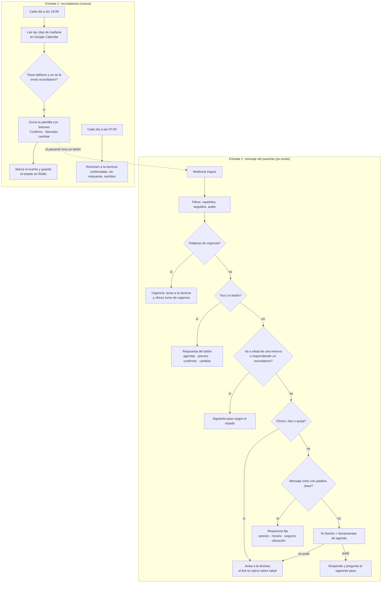

# Eli: asistente de EliDental

Diseño conversacional y técnico de Eli, la asistente por WhatsApp de **EliDental** (Loja, Ecuador).
Se basa en la encuesta a la doctora, en sus páginas públicas y en cómo se agenda en Latinoamérica.

**Estado (2026-10-07):** `version4` está en producción como Eli, con los datos públicos de EliDental.
Las prioridades de urgencia, pregunta clínica, foto y queja están hoy **en el prompt de la IA**. Falta
construir: reglas fijas antes de la IA, botones, aviso a la doctora y **recordatorios de cita**.
Mientras tanto, el prompt prohíbe prometer recordatorios o avisos, y deriva a la doctora a través del
WhatsApp del consultorio.

## 0. EliDental

Datos tomados el 2026-10-07 de su [Facebook](https://www.facebook.com/EliDentalec) y de su
[Instagram](https://www.instagram.com/elidentalec/) (biografía y las 64 publicaciones). Las publicaciones
anteriores a septiembre de 2024 tienen la dirección antigua (Mercadillo y Av. Universitaria).

| Dato | Valor | Fuente |
|---|---|---|
| Nombre | EliDental, «Odontología integral para toda la familia» | Facebook |
| Odontóloga | Dra. Viviana Elizabeth Sucunuta (@viviana_sucunuta), Universidad de Cuenca, posgradista en ortodoncia (Brasil) | Instagram |
| Dirección | Av. Manuel Agustín Aguirre 343-39, entre Miguel Riofrío y Azuay, Loja | Facebook |
| WhatsApp y celular | 099 970 1778 | Facebook |
| Correo | elidentalec@hotmail.com | Facebook |
| Fundación | 30 de abril de 2021 | Facebook |
| Servicios publicados | Limpieza (profilaxis con ultrasonido), resinas y cambio de amalgamas, ortodoncia, blanqueamiento, carillas, endodoncia, extracciones y muelas del juicio, prótesis total y fija (coronas, puentes), frenectomía; atención a niños y embarazadas; sedación para pacientes con miedo | Publicaciones de Instagram y Facebook |
| Servicios que agenda Eli | Consulta de valoración, Limpieza dental, Resina (calza), Control de ortodoncia, Urgencia dental | Definido para el bot |
| Precios | No publicados (rango «$$»; solo promociones antiguas, como 20 % en limpieza para parejas). Eli no da cifras: el valor lo confirma la doctora en la consulta | Facebook, Instagram |
| Horario | Lunes a viernes de 09:00 a 18:00, sábado de 09:00 a 15:00, domingo cerrado | Instagram, publicación de la mudanza (21/9/2024) |

## 1. Lo que pide la doctora

Encuesta del 17/9/2026 (una respuesta):

| Tema | Respuesta |
|---|---|
| Volumen | 80 a 200 pacientes activos, 10 a 25 citas por semana |
| Cómo agenda hoy | Llamada, WhatsApp, en persona, redes sociales y agenda en papel |
| Problemas | Coordinar cada cita le quita tiempo; los pacientes olvidan sus citas sin avisar; le escriben fuera de horario |
| Lo más importante | **Agendar sin intervenir** y **recordatorios automáticos** |
| Disponibilidad | 24 horas, 7 días; tolera caídas breves |
| Canales | WhatsApp, llamada, Messenger, Instagram |
| Tecnología | Uso básico (WhatsApp, redes, correo) |
| Presupuesto | Hasta $20 al mes; $100 a $300 de implementación |

Consecuencias de diseño:
- Los recordatorios no son opcionales: son la mitad del valor.
- 24/7 exige un servidor siempre encendido, no un computador personal.
- Cada mensaje de Meta cuesta (ver [Costos](#8-costos)), así que hay que cuidar el presupuesto de $20.
- Ella no va a usar n8n: todo lo que necesite saber le llega por WhatsApp.

## 2. Cómo se agenda en Latinoamérica

- El paciente escribe por WhatsApp y una recepcionista responde a mano. El problema principal no es
  agendar, sino que el paciente no llegue.
- Blogs de software dental hablan de un 15 % a 30 % de inasistencia, sin citar un estudio
  ([Dentalink](https://www.softwaredentalink.com/blog/como-disminuir-el-ausentismo-de-pacientes-en-una-clinica-dental)).
  Una revisión sistemática citada por
  [VioletWave](https://www.violetwaveai.com/blog/chatbot-whatsapp-turnos-odontologia) (McLean et al.,
  2016) encontró que los recordatorios mejoran la asistencia en torno a un 34 %.
- Buenas prácticas de recepción que Eli debe copiar: preguntar primero si es urgencia; en la primera
  visita, pedir llegar 10 minutos antes para la historia clínica
  ([Leadsales](https://leadsales.io/blog/whatsapp-para-consultorios-y-clinicas/)); confirmar con día,
  hora, profesional y dirección ([Medesk](https://www.medesk.net/es/blog/plantillas-de-comunicacion-para-clinicas/));
  recordar la cita el día anterior con un botón para confirmar; derivar a la doctora urgencias,
  necesidades especiales y reclamos.
- Por WhatsApp solo se envía logística, nunca diagnósticos
  ([Gestión Dental](https://gestiondental.org/whatsapp-confirmar-citas-dentales-ventajas-limites-buenas-practicas/)).

## 3. ¿Los recordatorios cambian el flujo?

Sí, de tres formas:

1. **Aparece una segunda entrada**, programada por horario: Eli escribe primero, sin que el paciente
   haya escrito.
2. **Llegan respuestas de botón** («Confirmo», «Necesito cambiar»). *Normalizar mensaje* hoy solo lee
   texto, y debe leer también el código del botón.
3. **Eli necesita contexto:** si el paciente responde «sí» a un recordatorio, ese «sí» confirma la cita
   del recordatorio, no una reserva nueva.



## 4. Cómo escribe el paciente y quién responde

| Tipo de mensaje | Ejemplos | Responde | Qué hace |
|---|---|---|---|
| Saludo | «hola doctora», «buenas tardes» | Regla fija | Saluda y muestra botones: Agendar cita · Tengo dolor · Precios y servicios |
| Urgencia | «me duele mucho una muela», «se me rompió un diente», «tengo la cara hinchada» | Persona | Avisa a la doctora al instante y ofrece el primer turno de urgencia |
| Primera cita | «quiero una cita», «quisiera una limpieza» | Botones | Pregunta si es primera vez, nombre, motivo, día y turno; confirma; pide llegar 10 min antes |
| Paciente que vuelve, con detalles | «el jueves en la tarde para mi control de ortodoncia» | IA | Entiende día, franja y motivo, revisa la agenda y pide confirmar |
| Precio | «cuánto cuesta una limpieza», «precio de brackets» | Regla fija | Precio fijo si existe; si no, el valor de la consulta y que el resto se define en la evaluación |
| Seguro | «aceptan mi seguro?» | Regla fija | Lista de seguros aceptados |
| Horario o ubicación | «a qué hora atienden», «dónde queda» | Regla fija | Horario, dirección y Google Maps |
| Ver, mover o cancelar | «no voy a poder ir mañana» | IA | Busca su cita y ofrece reagendar antes de cancelar |
| Respuesta al recordatorio | botón Confirmo / Necesito cambiar, o «sí», «no puedo» | Botones | Confirma, o abre el cambio de cita y libera el turno |
| Pregunta clínica | «es normal que sangre después de la extracción?» | Persona | No da consejos médicos; avisa a la doctora; si hay señales de alarma, trata el caso como urgencia |
| Foto de la boca o radiografía | imagen | Persona | La guarda para la doctora; la IA no la interpreta |
| Audio o sticker | nota de voz | Filtro | Pide que lo escriba |
| Cita para otra persona | «cita para mi hijo de 6 años» | IA | Pide nombre y edad del paciente y, si es menor, el nombre del adulto responsable |
| Queja o pide a la doctora | «quiero hablar con la doctora» | Persona | Avisa a la doctora y el bot se calla en esa conversación |

## 5. Reglas fijas

**Urgencia.** Disparadores: dolor fuerte, «me duele mucho», hinchado, sangra, se rompió, se cayó
(diente o corona), golpe, fiebre, pus. Eli responde:

> Lamento que estés con molestias. Ya le aviso a la doctora. El primer turno de urgencia es [día y
> hora], ¿te lo reservo? Si tienes la cara muy hinchada, fiebre alta o te cuesta tragar o respirar, ve a
> emergencias ahora.

La doctora recibe el aviso por WhatsApp aunque sea fuera de horario.

**Tipo de cita según el motivo.**

| Motivo | Turno |
|---|---|
| Dolor, golpe, algo roto | Urgencia (el primero libre) |
| Limpieza o control | Normal |
| Tratamiento nuevo (brackets, implantes, blanqueamiento, coronas) | Consulta de valoración primero |
| Control de un tratamiento en curso | Normal, con el motivo anotado |
| No sabe o «revisión» | Consulta de valoración |

**Primera vez:** nombre completo, edad y motivo. Al confirmar: «Llega 10 minutos antes para llenar tu
historia clínica».

**Precios:** solo los fijos que apruebe la doctora. Nunca se inventa un precio.

**Privacidad:** los mensajes automáticos solo llevan día, hora y lugar.

**Fuera de horario:** se agenda igual. Lo que necesita a la doctora se responde con «La doctora te
responderá a partir de las [hora]».

## 6. Recordatorios

### Plantilla (Meta, categoría UTILITY, idioma `es`)

Nombre propuesto: `recordatorio_cita`

```
Hola {{nombre}}, te recordamos tu cita en {{consultorio}} mañana {{dia}} a las {{hora}}.
¿Nos confirmas tu asistencia?
[Confirmo]  [Necesito cambiar]
```

- Los botones son *quick reply*, con payload `confirmar:<eventId>` y `cambiar:<eventId>`. Así la
  respuesta dice exactamente a qué cita se refiere.
- La plantilla se crea en Kapso o en Meta y **debe aprobarla Meta** antes de usarse. Solo lleva
  logística, para que la clasifiquen como UTILITY y no como MARKETING.
- Se envía con el nodo Kapso, operación **Send Template**
  ([documentación de Kapso](https://docs.kapso.ai/docs/whatsapp/n8n)).

### Datos que necesita cada cita

El evento de Google Calendar es la fuente de verdad. `version4` ya escribe en la descripción:

```
Paciente: <nombre>
Tel: <teléfono>
Servicio: <servicio> ($<precio>)
```

Se agregan dos líneas que el recordatorio actualiza:

```
Recordatorio: enviado 2026-10-07 18:00
Estado: pendiente | confirmada | cambio pedido
```

Las citas que la doctora crea a mano **deben llevar la línea `Tel:`**; si no la tienen, no reciben
recordatorio y aparecen como «sin teléfono» en el resumen.

### Estado en Redis (DB 1)

| Clave | Valor | Duración | Uso |
|---|---|---|---|
| `v4:reminder:sent:<eventId>` | `1` | 3 días | No enviar dos veces el mismo recordatorio |
| `v4:reminder:<teléfono>` | `<eventId>` | 36 h | Si el paciente responde con texto («sí», «no puedo»), saber a qué cita se refiere |
| `v4:state:<teléfono>` | paso de la reserva | 2 h | Reserva guiada con botones |
| `v4:handoff:<teléfono>` | `1` | lo decide la doctora | El bot no responde mientras la doctora atiende |

### Cuándo y a quién

| Momento | Acción |
|---|---|
| Al confirmar una cita nueva | «Te enviaremos un recordatorio por WhatsApp el día anterior» (consentimiento) |
| Día anterior, 18:00 | Plantilla a cada cita de mañana con teléfono y sin recordatorio enviado |
| Toca **Confirmo** | `Estado: confirmada`, evento en verde, «¡Gracias! Te esperamos mañana a las [hora]» |
| Toca **Necesito cambiar** | `Estado: cambio pedido`; Eli ofrece turnos para otro día; al reservar el nuevo turno, borra el anterior |
| Responde con texto | Si hay un `v4:reminder:<teléfono>`, «sí» confirma y «no puedo» abre el cambio; lo ambiguo va a la IA con ese contexto |
| Mismo día, 07:00 | Resumen a la doctora: confirmadas, sin respuesta, cambios pedidos y citas sin teléfono |
| Opcional, 2 h antes | Segundo aviso solo a las que siguen sin confirmar (cuesta otro mensaje) |

### Construcción en n8n

1. **Normalizar mensaje:** además de `text.body`, leer el payload del botón de una plantilla
   (`message.button.payload`) y de un botón interactivo (`message.interactive.button_reply.id`).
   Comprobar el formato exacto con un mensaje real en **Executions**.
2. **Rama «¿Tocó un botón?»** antes del agente: `confirmar:<id>` actualiza el evento y responde;
   `cambiar:<id>` guarda el contexto y pasa al agente con «el paciente quiere cambiar la cita <id>».
3. **Workflow nuevo `Eli · Recordatorios`:** *Schedule Trigger* (18:00) → *Google Calendar: Get Many*
   (mañana) → *Code*: extraer `Tel:` y filtrar → *Redis*: ¿ya enviado? → *Kapso: Send Template* →
   *Google Calendar: Update* (descripción) → *Redis*: marcar enviado.
4. **Resumen de la mañana:** *Schedule Trigger* (07:00) → citas de hoy → *Code*: agrupar por estado →
   *Kapso: Send Text* al número de la doctora. Este mensaje cae fuera de la ventana de 24 h si ella no
   escribió al bot, así que necesita su propia plantilla UTILITY.
5. Probar con un evento en un calendario de prueba y con el número propio, nunca con pacientes reales.

## 7. Qué pasa si…

| Si el paciente… | Eli… |
|---|---|
| No responde al recordatorio | Queda «sin respuesta» en el resumen de la doctora; opcional, segundo aviso 2 h antes |
| Cancela el mismo día | Libera el turno y ofrece reagendar |
| No llega a la cita | Al día siguiente, «Te esperamos ayer, ¿reagendamos?», solo si la doctora lo aprueba |
| Tiene una urgencia y no hay turnos hoy | Avisa a la doctora para que decida si lo atiende fuera de agenda, y da la indicación de emergencias |
| Tiene una urgencia a las 2 de la mañana | Mensaje fijo de urgencia, indicación de emergencias y aviso a la doctora |
| Elige el mismo turno que otro paciente al mismo tiempo | Un lock de Redis por turno (`v4:slot:<fecha>T<hora>`, 60 s) reserva solo el primero; el segundo recibe otras opciones |
| Agenda para un menor | Pide el nombre del adulto responsable y la edad |
| Pidió urgencia y luego dice «ya no me duele» | Ofrece cambiarla a un turno normal |
| Insiste en un diagnóstico | No diagnostica; ofrece consulta o aviso a la doctora |
| Escribe por Instagram o Messenger | Fuera del alcance de Kapso: esas redes responden con un enlace al WhatsApp |
| Pide un turno que la doctora dio por teléfono | Si no está en el mismo calendario, el bot podría darlo: todo turno va al mismo calendario |
| Escribe cuando la IA o el servidor fallan | «Escríbeme en unos minutos» y aviso a la doctora; la regla de urgencia no depende de la IA |
| Envía un diagnóstico de otro médico | No lo repite; queda solo para la doctora |

## 8. Costos

Desde el **1 de octubre de 2026**, Meta cobra por mensaje: las plantillas (marketing, utility) y también
las respuestas de servicio y utility dentro de la ventana de 24 horas
([precios de Meta](https://developers.facebook.com/docs/whatsapp/pricing)).
La tarifa depende del país del destinatario: consulta la tabla vigente para Ecuador antes de cotizar.

Volumen esperado con 10 a 25 citas por semana: unos 40 a 100 recordatorios al mes, más el resumen
diario a la doctora (unos 30) y las respuestas de cada conversación. Con el presupuesto de $20 al mes,
el segundo aviso de 2 horas antes y los mensajes de «no llegaste» solo se activan si los números
cierran.

## 9. Decisiones pendientes con la doctora

- [ ] Confirmar que el horario publicado en 2024 sigue vigente y si hay pausa de almuerzo
- [ ] Duración de cada tipo de cita (valoración, limpieza, resina, control, urgencia)
- [ ] Cuántos turnos de urgencia reserva por día, y en qué horas
- [ ] Si Eli puede dar algún precio (hoy no da ninguno), por ejemplo el de la consulta de valoración
- [ ] Seguros que acepta
- [ ] Si atiende niños, y desde qué edad
- [ ] Datos de un paciente nuevo (nombre y edad; ¿cédula?)
- [ ] Número que recibe los avisos de urgencias, quejas y el resumen diario
- [ ] Hora del recordatorio (propuesta: 18:00 del día anterior) y si se envía el segundo aviso
- [ ] Si se escribe al paciente que no llegó
- [ ] Recordatorios de control cada 6 meses
- [ ] Qué calendario usa, para que todo turno quede en el mismo lugar
- [ ] Dónde corre el bot: un servidor pequeño en la nube, para cumplir el 24/7 dentro de $20 al mes

## Fuentes

- [Dentalink: WhatsApp para clínicas dentales](https://www.softwaredentalink.com/blog/whatsapp-clinicas-dentales)
- [Dentalink: reducir el ausentismo](https://www.softwaredentalink.com/blog/como-disminuir-el-ausentismo-de-pacientes-en-una-clinica-dental)
- [VioletWave: chatbot de WhatsApp para turnos dentales](https://www.violetwaveai.com/blog/chatbot-whatsapp-turnos-odontologia)
- [Gestión Dental: ventajas y límites de WhatsApp](https://gestiondental.org/whatsapp-confirmar-citas-dentales-ventajas-limites-buenas-practicas/)
- [Leadsales: WhatsApp para consultorios](https://leadsales.io/blog/whatsapp-para-consultorios-y-clinicas/)
- [Medesk: plantillas de comunicación](https://www.medesk.net/es/blog/plantillas-de-comunicacion-para-clinicas/)
- [Kapso: n8n](https://docs.kapso.ai/docs/whatsapp/n8n) y [plantillas con botones](https://docs.kapso.ai/docs/whatsapp/templates/buttons)
