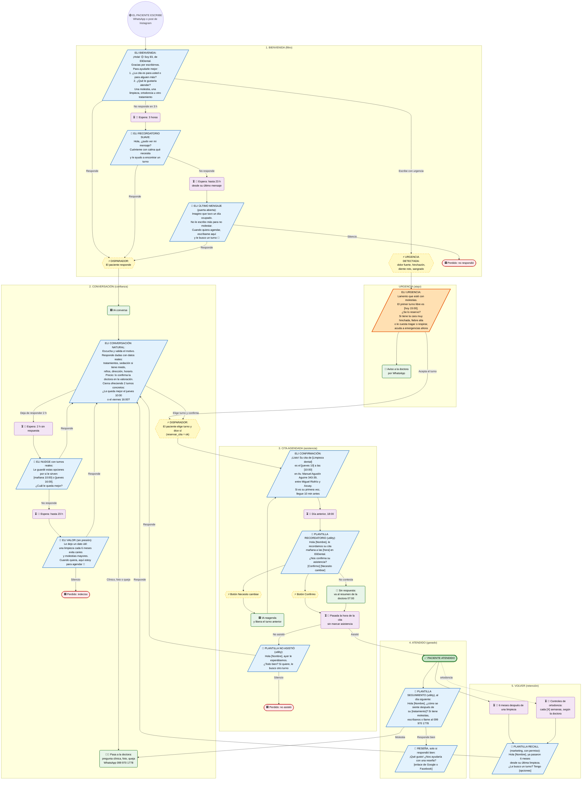

# Embudo de conversación de Eli (EliDental)

Recorrido de un paciente por WhatsApp, desde el primer mensaje hasta volver a la limpieza de los 6
meses. Eli conversa como una persona del consultorio. La diferencia es que sabe qué responder y qué no,
con la información real de EliDental. Cada etapa tiene sus mensajes, sus esperas y cuándo se da por
perdido o por ganado.

Imagen para compartir: [img/embudo-elidental.png](img/embudo-elidental.png).

**Leyenda:** 🟦 mensaje de Eli · 🟩 conversación (IA o la doctora) · 🟨 disparador · 🟪 espera ·
🟥 perdido · ✅ ganado. Lo marcado con 🔧 **todavía no está construido** en n8n; el resto ya funciona hoy.

## Etapa por etapa

### 1. Bienvenida (filtro)

| | |
|---|---|
| Objetivo | Saber para quién es la cita y el motivo, en el primer mensaje |
| Mensaje | «¡Hola! 😊 Soy Eli, de EliDental. Gracias por escribirnos. Para ayudarle mejor: 1. ¿La cita es para usted o para alguien más? 2. ¿Qué le gustaría atender: una molestia, una limpieza, ortodoncia u otro tratamiento?» |
| Atajo | Si el primer mensaje ya trae urgencia, se salta la bienvenida y va a **Urgencia** |
| Si no responde | A las 3 h, recordatorio suave. Cerca de las 23 h, último mensaje con la puerta abierta. Después, perdido |
| Hoy | ✅ El saludo y la pregunta los hace la IA. 🔧 Los recordatorios por tiempo no existen todavía |

### Urgencia (atajo)

| | |
|---|---|
| Disparadores | Dolor fuerte, «me duele mucho», hinchado, sangra, se rompió, se cayó un diente o corona, golpe, fiebre, pus |
| Mensaje | Empatía en una frase, el **primer turno libre real** (de Google Calendar) y la indicación de ir a emergencias si los síntomas son graves |
| Hoy | ✅ Funciona por el prompt de la IA. 🔧 Falta el aviso automático a la doctora |

### 2. Conversación (confianza)

| | |
|---|---|
| Objetivo | Que el paciente se sienta escuchado y termine eligiendo un turno |
| Cómo habla Eli | Trato de usted, cálido, mensajes de 2 a 6 líneas, máximo un emoji. Valida el motivo («entiendo, una molestia así incomoda mucho»), responde con datos reales y **cierra siempre con dos turnos concretos**, sin preguntas abiertas como «¿cuándo puede?» |
| Lo que sabe | Tratamientos, sedación para pacientes con miedo, atención a niños y embarazadas, dirección, horario (L–V 09:00–18:00, sábado 09:00–15:00) |
| Lo que no hace | No da precios (los confirma la doctora en la valoración), no diagnostica, no interpreta fotos, no inventa horarios |
| Pasa a la doctora | Pregunta clínica, foto, queja o «quiero hablar con la doctora»: le da el WhatsApp 099 970 1778 |
| Si deja de responder | A las 2 h, «nudge» con **dos turnos reales**. Cerca de las 23 h, mensaje de valor sin presión. Después, perdido (indeciso) |
| Hoy | ✅ Conversación, turnos reales, reserva y derivación. 🔧 Nudges por tiempo |

### 3. Cita agendada (asistencia)

| | |
|---|---|
| Confirmación | Servicio, día, hora y dirección completa. Si es su primera vez, llegar 10 minutos antes |
| Recordatorio | Día anterior a las 18:00, **plantilla de Meta** con botones «Confirmo» y «Necesito cambiar» |
| Necesito cambiar | Eli ofrece otros turnos, reserva el nuevo y libera el anterior |
| Sin respuesta | Aparece en el resumen de las 07:00 para la doctora |
| No asistió | Al día siguiente, plantilla «¿Todo bien? ¿Le busco otro turno?». Si no responde, perdido |
| Hoy | ✅ Confirmación. 🔧 Recordatorio, resumen y «no asistió» (diseño en [eli-dental.md](eli-dental.md#6-recordatorios)) |

### 4. Atendido (ganado)

| | |
|---|---|
| Seguimiento | Al día siguiente: «¿Cómo se siente después de su tratamiento?». Si hay molestias, pasa a la doctora |
| Reseña | **Solo** si respondió bien: pedir una reseña con el enlace de Google o Facebook |
| Hoy | 🔧 Todo por construir. Hace falta marcar «asistió» en el evento del calendario |

### 5. Volver (retención)

| | |
|---|---|
| Limpieza | A los 6 meses: plantilla de marketing con dos turnos. Solo a quien aceptó recibir mensajes |
| Ortodoncia | Controles periódicos, con la frecuencia que indique la doctora |
| Hoy | 🔧 Por construir |

## Reglas que hacen que suene humano y no a bot

1. **Una pregunta por mensaje**, salvo en la bienvenida (dos, numeradas).
2. **Siempre dos opciones concretas** de turno. Nunca «¿qué día puede?» sin opciones.
3. **Validar antes de vender:** primero el motivo o la molestia, después el turno.
4. **Nombrar al paciente** cuando ya lo sabemos.
5. **El seguimiento se corta apenas el paciente responde.** Nunca dos recordatorios seguidos.
6. **Sin presión falsa.** Nada de «URGENTE» ni de «se liberó un espacio» si no es verdad: en salud, la
   confianza vale más que la conversión. La escasez real sí se usa: si alguien cancela, Eli puede ofrecer
   ese turno a quien lo pidió (🔧 lista de espera).

## Lo que exige WhatsApp

| Situación | Qué se puede enviar | Costo |
|---|---|---|
| Hasta 24 h después del último mensaje del paciente | Cualquier mensaje (texto, botones) | Respuestas de servicio: 1.000 gratis al mes por número, después se cobran |
| Más de 24 h | Solo **plantillas aprobadas por Meta** | Se cobran por mensaje |

Por eso los seguimientos de las etapas 1 y 2 terminan **antes de las 23 h**: son los últimos mensajes
libres y gratis. Todo lo de las etapas 3 a 5 (recordatorio, no asistió, seguimiento, recall) son
plantillas:

| Plantilla | Categoría | Botones |
|---|---|---|
| `recordatorio_cita` | Utility | Confirmo · Necesito cambiar |
| `cita_no_asistio` | Utility | Buscar otro turno |
| `seguimiento_tratamiento` | Utility | — |
| `recall_limpieza` | Marketing (requiere permiso del paciente) | Agendar |

## Cómo se construye en n8n

| Pieza | Qué hace | Estado |
|---|---|---|
| `version4` (webhook) | Bienvenida, conversación, urgencia, reserva, derivación | ✅ En producción |
| Estado en Redis | `v4:stage:<tel>` (bienvenida, conversación, agendado, atendido), `v4:last_in:<tel>` (hora del último mensaje del paciente), `v4:nudge:<tel>` (seguimientos enviados) | 🔧 |
| Workflow `Eli · Seguimiento` | Cada 15 min revisa las conversaciones sin respuesta y envía el seguimiento de su etapa (3 h y 23 h en bienvenida; 2 h y 23 h en conversación). Para si el paciente respondió | 🔧 |
| Workflow `Eli · Recordatorios` | Día anterior a las 18:00: plantilla con botones; 07:00: resumen a la doctora | 🔧 Diseño listo |
| Workflow `Eli · Después de la cita` | No asistió, seguimiento, reseña y recall | 🔧 |
| Aviso a la doctora | Urgencias, quejas, preguntas clínicas | 🔧 |

Orden sugerido: 1) estado en Redis y seguimientos de las etapas 1 y 2, que son gratis y dentro de la
ventana; 2) recordatorios; 3) aviso a la doctora; 4) después de la cita y recall.

## Cómo medirlo

| Métrica | Pregunta que responde |
|---|---|
| Conversaciones nuevas por semana | ¿Cuánta gente escribe? |
| % que responde la bienvenida | ¿El primer mensaje engancha? |
| % que agenda | ¿La conversación convence? |
| % que confirma el recordatorio | ¿Llegan informados? |
| % que no asiste | ¿Los recordatorios funcionan? |
| % que vuelve a los 6 meses | ¿Hay retención? |

## Fuentes

- [Doctocliq: convertir leads en pacientes desde WhatsApp](https://www.doctocliq.com/blog/convertir-leads-pacientes-whatsapp-clinica-dental)
- [Kura: agente de IA para clínicas dentales](https://getkura.ai/en/ai-dental-clinics)
- [Aurora Inbox: chatbot de WhatsApp para clínicas dentales](https://www.aurorainbox.com/en/2026/05/15/chatbot-dental-clinics-via-whatsapp/)
- [Dentalclinically: recall por WhatsApp](https://dentalclinically.com/whatsapp-automation-for-dental-clinics/)
- [Updent: recuperar pacientes inactivos](https://updent.es/blog/recuperar-pacientes-inactivos-clinica-dental/)
- [smsmode: ventana de 24 h y plantillas](https://www.smsmode.com/en/whatsapp-business-api-customer-care-window-ou-templates-comment-les-utiliser/)

Las cifras de estos sitios son de empresas que venden automatización: sirven de referencia, no como
estudios.
