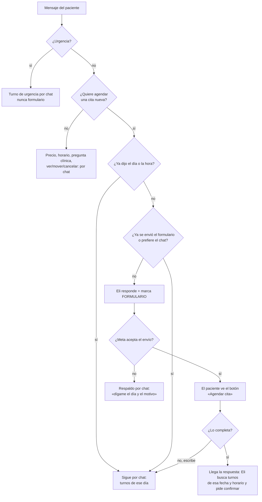

# Formulario de cita (WhatsApp Flow)

Eli puede enviar un formulario dentro de WhatsApp para agendar: **datos → motivo → fecha y horario**.
La respuesta vuelve al chat, y Eli muestra los turnos libres de ese día.

| | |
|---|---|
| Archivo | [`flows/eli-agendar-cita.flow.json`](../flows/eli-agendar-cita.flow.json) (Flow JSON 7.2, estático, sin endpoint) |
| En Kapso | `eli_agendar_cita` · id Kapso `5b81111e-3e68-425e-bedf-b008d2d7f122` · **Meta Flow ID `1972695790065650`** |
| Estado | **Borrador.** Meta rechaza publicarlo (`422 Integrity requirements not met`): ver [Activar](#activar) |
| En n8n | `version4` ya lo envía en **modo borrador** (`FLOW_MODO = 'draft'` en el nodo *Preparar respuesta*) |

## Cuándo se envía y cuándo no



| Situación | ¿Formulario? | Por qué |
|---|---|---|
| «Quiero una cita», «quisiera una limpieza», elige agendar tras el saludo | **Sí** | Recoge nombre, edad, motivo y fecha sin ir y venir |
| Urgencia («me duele mucho») | No | La velocidad importa más: turno de urgencia por chat |
| «Mañana a las 10 una limpieza» | No | Ya tiene lo necesario: un formulario sería un paso extra |
| Pregunta precio, horario o dirección | No | Respuesta directa |
| Pregunta clínica, foto, queja | No | Va a la doctora |
| Ver, mover o cancelar una cita | No | Lo resuelve el agente con el calendario |
| Ya se envió en esta conversación | No | No insistir |
| «Prefiero por aquí», «no me abre» | No | Se sigue por chat |
| Escribe en vez de completarlo | No (sigue el chat) | El formulario es una ayuda, no una obligación |

La decisión la toma el agente según el prompt (sección *FORMULARIO DE CITA*). Cuando corresponde,
termina su respuesta con `[[FORMULARIO]]`. El nodo *Preparar respuesta* quita la marca y arma el mensaje.

## Pantallas

1. **DATOS:** para quién es la cita, nombre completo, edad y adulto responsable (si es menor).
2. **MOTIVO:** limpieza, resina, control de ortodoncia o valoración; si es su primera vez; información
   sobre sedación. Avisa que una urgencia se atiende por chat.
3. **PREFERENCIA:** fecha (entre hoy y 60 días, sin domingos), mañana, tarde o cualquier hora, y la
   aceptación de recordatorios por WhatsApp (obligatoria).

Las fechas límite y los domingos se envían al abrir el formulario (`flow_action_payload.data`), así el
JSON no cambia cada día.

## Cómo funciona en n8n

```
Agente version4 → Preparar respuesta → ¿Enviar formulario?
                                         ├─ sí → Enviar formulario (Kapso, Send Raw Payload) ─ si falla ─┐
                                         └─ no → Responder por WhatsApp ◄────────────────────────────────┘
```

- **Enviar:** mensaje `interactive` de tipo `flow` con `flow_id`, `flow_cta: "Agendar cita"`,
  `flow_token: cita:<teléfono>:<hora>`, `flow_action: navigate` hacia la pantalla `DATOS`.
- **Recibir:** el paciente responde con un mensaje `interactive` → `nfm_reply`. Kapso lo entrega
  ya interpretado en `message.kapso.flow_response`. *Normalizar mensaje* lo convierte en un texto que
  empieza con `[FORMULARIO DE CITA COMPLETADO]` y lo pasa al agente.
- **Respaldo:** si Meta rechaza el envío, se responde por chat pidiendo el día y el motivo. El
  paciente nunca queda sin respuesta.

## Activar

Meta no deja publicar flows en esta cuenta. La revisión de Kapso (2026-10-07) muestra:

- [ ] **Facturación de la cuenta de WhatsApp:** error del método de pago (`141006`). Agrega un método
  de pago válido en Meta Business → *Configuración del negocio → Cuentas de WhatsApp → Pagos*. Esto
  además bloquea los recordatorios.
- [ ] **Nombre visible del número sin aprobar** (hoy «Nooki Envio Gratis»). Para EliDental conviene que
  sea «EliDental» en su propio número.
- [ ] **Verificación del negocio** en Meta Business (*Centro de seguridad*), si no está hecha.

Cuando se resuelva:

1. Publica el flow desde Kapso (*WhatsApp Flows → eli_agendar_cita → Publish*), o pídeselo a Claude.
2. En n8n, nodo **Preparar respuesta**: cambia `FLOW_MODO = 'draft'` por `'published'`, guarda y publica.

Mientras está en borrador, Meta puede aceptar el envío en modo `draft` para pruebas o rechazarlo con el
mismo bloqueo de integridad. En ese caso funciona el respaldo por chat.

> Un flow publicado **no se puede editar**. Para cambiarlo: edita el JSON, valídalo con
> `scripts/check-flow.py`, crea una versión o un flow nuevo en Kapso y actualiza `FLOW_ID` en
> *Preparar respuesta*.

## Validar cambios

```bash
scripts/check-flow.py flows/eli-agendar-cita.flow.json
```

Revisa propiedades permitidas, referencias entre pantallas, datos pasados con `navigate`, un `Footer`
por pantalla y que la pantalla final use `complete`. La validación definitiva la hace Meta al crear el
borrador en Kapso.

## Más adelante: turnos dentro del formulario

Este formulario es **estático**: no conoce los turnos libres, por eso Eli los muestra en el chat. La
versión dinámica mostraría los turnos dentro del formulario con un *data endpoint* (una función de Kapso
que consulte la agenda), con cifrado configurado por número. Conviene hacerla cuando la versión
estática esté publicada y probada.
